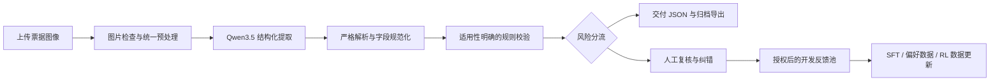

# Qwen3.5 票据智能提取：双项目融合与深化方案

> 编写日期：2026-11-20。第 1–12 节保留设计方案与历史审查口径，不是实验成绩声明；独立项目当前实现、可运行命令与未完成边界见第 13 节。
>
> 代码审查基线：`Qwen3.5-VL-Finetune@fff1851`、`qwen-receipt-ocr@cbcabfe`。审查对象为两个本地仓库的代码、README 和结果文档；本次没有下载数据、加载模型、运行训练或复现实验。本文中的历史数值均来自第二个仓库的记录，新的目标和预算均属于建议。
>
> 第一阶段仅创建方案。第二阶段按用户要求在 `D:/GitHub/Qwen3.5-receipt-ocr` 新建独立 Git 项目，代码与真实 CORD 数据已迁入；不移动、不修改两个源项目，不合并源 Git 历史。

## 1. 项目定位与核心决策

### 1.1 一句话定位

**面向真实拍照小票和多版式票据的 Qwen3.5 结构化提取与可靠交付系统：从图像到可校验 JSON，以数据治理、SFT、偏好优化和可验证奖励强化学习改善商品明细、关键字段与跨域泛化，并用人工复核闭环控制错误交付。**

建议对外项目名为 **Qwen3.5-Receipt-Intelligence**。仓库暂不改名，先在现有 `Qwen3.5-VL-Finetune` 上增量建设。

业务的核心交付不是“模型能 OCR”，而是：用户上传一张票据，得到可供票据归档、消费记录或下游业务系统使用的结构化字段、商品明细、校验结果和复核状态。应用价值需用正确交付率、复核工作量和处理成本验证，不虚构真实客户、营收或效率提升。

### 1.2 融合方式

- **以当前仓库为算法主干**：保留 Qwen3.5 专用模型加载、SFT/DPO/GRPO/分类训练器和多模态数据处理。
- **以票据仓库为业务来源**：迁移并改造 FATURA 数据处理、票据提示词、批量推理、指标与上传 API 的业务逻辑。
- **不把两个训练框架直接拼成一套依赖**：主线用当前原生 Transformers/TRL/PEFT 训练路径；MS-SWIFT 只作为独立环境中的历史 SFT/DoRA 对照。
- **优先做同一业务上的纵深**：`数据修正 → SFT → DPO 或 GRPO → 可靠交付`。`SFT → DPO → GRPO` 是需要验证的实验分支，不预设叠加必然更好。
- **主实验以 Qwen3.5-4B dense 为对象**；2B 是低预算备选，9B 是资源允许时的质量参照/离线候选生成模型。首版不扩展 Qwen3.6、MoE、视频或所有算法变体。
- **先建可信评估，再做高级算法**：不能把高 FATURA 分数、合法 JSON 或奖励上升等同于真实业务效果。

### 1.3 三个必须回答的研究问题

1. **域迁移**：为什么合成票据字段分数很高，真实手机拍照小票仍漏商品、输出空 JSON？真实明细标注、混合训练和视觉适配分别能改善多少？
2. **结构与忠实性**：相比只用 SFT，DPO/GRPO 能否降低字段错归属、漏项和幻觉，同时保留原文信息，而不是仅让输出格式更漂亮？
3. **效果与成本**：在相同推理预算下，4B 的数据和后训练改进能否缩小与 9B 的差距？分辨率、视觉 LoRA、约束解码和复核分流的投入是否划算？

## 2. 两个仓库的实际基础与不足

### 2.1 能力盘点

| 维度 | 当前算法仓库 | 票据仓库 | 融合判断 |
|---|---|---|---|
| 模型范围 | `src/model/load_model.py` 只保留 `qwen3_5` / `qwen3_5_moe` | `03_train.py` 用 MS-SWIFT，覆盖多个模型家族 | 主线收敛 Qwen3.5 dense，不回退混合注册表 |
| SFT | `src/train/train_sft.py`、`src/trainer/sft_trainer.py`，含 LoRA、量化入口、视觉/merger 控制 | `03_train.py` 有 SFT、LoRA/DoRA、训练参数与结果记录 | 复用原生训练器，SWIFT 保留为独立对照 |
| 偏好学习 | `src/train/train_dpo.py`、`src/dataset/dpo_dataset.py` | 没有票据偏好训练流程 | 新建错误驱动偏好数据，复用 DPO 算法 |
| 强化学习 | `src/train/train_grpo.py`、`src/trainer/grpo_trainer.py` | 没有票据奖励与 RL 流程 | 改成票据专用 RLVR，不直接使用数学奖励 |
| 分类与长尾损失 | `train_cls.py`、`cls_trainer.py`、`src/loss/` | 没有分类业务链路 | 有真实分类标签后，可用于票据类型/拍摄质量分流；不强塞进核心路线 |
| 数据准备 | 通用 LLaVA 风格 JSON，缺票据数据治理 | `02_create_dataset.py`：FATURA 转换、模板过滤、图像增强、SWIFT 格式与 schema 生成 | 迁移数据逻辑但修正泄漏、占位表格和缺失监督 |
| 离线评估 | SFT 有生成式评估基础，但无票据指标体系 | `05_evaluate.py`：字段 Exact Match、CER、ROUGE/BLEU；`results/` 有历史表 | 补商品明细、空输出、幻觉、整单正确率及成本 |
| 推理/服务 | `src/serve/app.py` 是通用 Gradio 聊天演示 | `04_inference.py`：vLLM 批量推理；`06_api_wrapper.py`：图片上传与 document/receipt 模式 | 迁移批推理与 API，改造成可校验的业务交付 |
| 合并权重 | `src/merge_lora_weights.py` 处理 base-only 张量；`src/utils.py` 检查非 LoRA 权重匹配 | `merge_adapter.py` 合并 LoRA/DoRA | 必须统一合并契约并验证 dtype、MTP 与适配器兼容 |
| 蒸馏/线上反馈 | 本次未发现完整蒸馏、业务反馈或自动选样流水线 | 无完整闭环 | 明确标为新增/选做，不能当作已有能力 |

### 2.2 可直接支撑项目主线的历史观察

来源：`D:/GitHub/qwen-receipt-ocr/results/RESULTS.md` 与该仓库 README。

- FATURA 历史测试为 **250 张、34 个字段**。按 dev loss 选择的 4B run 2 checkpoint-700，记录字段 EM **99.46%**。这是特定评估脚本与已标注字段上的成绩，不是整张票据全对率。
- 26 张真实拍照票据的图片、逐条标注和模型输出是私有数据，**不在仓库中**；仓库仅有成绩表。因此目前无法直接复现这部分结论。
- 4B run 2 checkpoint-700 在真实票据上，泛化提示词的 52 次响应有 **33 次空响应**；其商品 JSON 指标在 1x/4x 下均为 **0**。
- 9B run 2 checkpoint-900 在 4x 分辨率下，历史记录商品价格正确提取为 **41/41**，但样本量仅 26 张，不能推导生产泛化能力。
- 结果文档指出 FATURA 的 `TABLE` 标签均为 `[[{}]]`，模型会学习该占位结构。需要重新审计原始标注；不能凭该占位符断言图片里没有明细。
- 图像预算从 **602112** 提高到 **2408448** 后，历史转写指标改善约 4–7 个百分点；更高分辨率并未保证所有模型的结构化提取同步改善。
- 发布的 9B checkpoint 曾根据 FATURA test 和这 26 张票据挑选。文档也承认其成绩对新文档偏乐观。这批数据若未来获授权，只能作为历史诊断/开发参考，不能重新命名为全新盲测。

**项目的切入点：纠正“合成字段指标优秀，但真实票据商品明细与可靠性差”的错位，而不是再刷一个 FATURA 单点分数。**

### 2.3 必须先解决的接入问题

1. **格式不兼容**：SWIFT 用 `messages` / `images`；当前 SFT/GRPO 用 `conversations` / `image`，DPO 用 `prompt` / `chosen` / `rejected`。不能直接把业务数据文件传进现有入口。
2. **system 与非思考模板对齐**：当前 SFT 按 user/assistant 成对处理，不能简单加入 SWIFT 的 system turn。业务指令需由统一 prompt renderer 放入 user 内容，并在服务端使用同一逻辑；复现旧 SWIFT 基线时另保留旧模板。`enable_reasoning=False` 不意味着无需核对空 think scaffold。
3. **奖励不匹配**：`src/train/reward_funcs.py` 的 `accuracy_reward` 是数学校验/整串匹配，`format_reward` 要求 `<think>...<answer>`，与直接输出票据 JSON 的非思考任务冲突。
4. **奖励载入不透明**：`train_grpo.py` 固定加载 `train.reward_funcs`；`src/utils.py::load_reward_funcs()` 自动发现所有 `_reward` 函数。需要显式指定奖励入口与顺序，避免辅助函数或消融版本意外被加载。
5. **评估集未接通**：DPO/GRPO 的 `make_*_data_module()` 当前返回 `eval_dataset=None`。要接入现有 `DataArguments.eval_path`，并额外做固定生成式业务评估。
6. **阶段初始化缺少完整契约**：训练入口主要按 `model_id` 加载模型、构造新 adapter，并按同一个输出目录恢复 checkpoint。`lora_weight_path` 的字段声明不代表已实现跨阶段加载；SFT→DPO/GRPO 需显式定义初始化和 reference。
7. **配置不等于已生效**：当前参数中有 `use_dora`，但审查到的原生 `LoraConfig` 构造未传入它。不能声称原生 DoRA 可用；需要接线、排除风险投影并验收，或者只放在 SWIFT 对照。
8. **合并保护仍不充分**：当前 merge 对非本地 base 会跳过 base-only 检查；加载工具默认 fp16，不能仅凭 README 就认定 fp32 敏感张量已无损保留。外部 DoRA adapter 也未必有当前工具要求的 `non_lora_state_dict.bin`。
9. **默认脚本不适合长票据**：通用 GRPO 默认 `max_prompt_length=512`、`max_completion_length=256`、低图像预算，且冻结策略不是最小 LoRA 基线。需按实际 token 分布重设，先测截断率与可训练参数。
10. **服务尚非可靠业务 API**：现有 wrapper 对非法 JSON 返回 `raw_text` 但仍可能 HTTP 200；无请求超时、schema/金额校验、复核状态或成本记录。不能将“请求成功”当成“业务提取成功”。

## 3. 业务范围、用户流程与边界

### 3.1 首版场景

**主场景：真实手机拍照消费小票的结构化归档。**

用户角色包括票据提交者和结果复核者。输入是单张 jpg/png 票据照片；输出包括商户、日期、金额、付款方式和商品列表。系统保留原文，对关键字段缺失、金额冲突、疑似漏明细或解析失败的结果进入人工复核。

**辅助场景：FATURA 多版式 invoice 的既有字段提取。**

它用来复现历史基线、测跨模板能力和监测遗忘，不将其标签自动等同于真实小票标签。两个任务保留不同 schema，通过共同数据清单、训练器、评估和服务框架接入。

### 3.2 最小业务闭环



复核反馈只能进入新的训练/开发版本；锁定测试集永远不参加此闭环。

### 3.3 首版不做

- 不声称已有企业客户、线上生产数据或真实效率收益。
- 不做发票真伪鉴定、税务合规判断、自动审批、自动支付或真实账务写入。
- 不把模型猜测当作纸面原文；不为满足加总规则自动改写票据金额。
- 不做多页 PDF、视频、印章鉴定或万能文档理解平台。
- 不从私有 26 张照片推导可公开数据集，也不未经授权获取/发布它们。
- 不为展示算法数量强行加入分类、蒸馏和所有 GRPO loss 变体。

## 4. 数据建设与统一契约

### 4.1 数据分层及建议规模

| 数据层 | 用途 | 建设要求 |
|---|---|---|
| FATURA 历史轨 | 复现 SWIFT/原生 SFT 和历史字段口径 | 获取获许可的原始数据；保留旧转换配置与独立成绩，不把修正后结果冒充历史复现 |
| FATURA 修正轨 | 共同算法比较、辅助 invoice 任务 | 审计 bbox、空表格、字段归属、切分和 schema 来源；不把未经标注明细作为空标签训练 |
| 真实小票核心集 | 主业务训练、开发、盲测 | 建议约 1000–2000 张独立原图；覆盖多商户、多版式、不同拍摄设备、长短小票与中英文 |
| 困难/缺失集 | 低质量、裁切、空字段与幻觉评估 | 在核心集之外或分层内部固定分组；记录退化类型、严重度和字段可读性 |
| 偏好集 | DPO | 从 train-only 小票上采候选，目标 1000–3000 对合格样本；不按数量硬凑 |
| RL 集 | GRPO/RLVR | 从 train-only、关键字段及明细已审定的 500–1500 张起步；可与 SFT 训练图重合，必须记录重合比例 |

这些规模是建设建议，不是已存在数据。若目前没有真实小票资源，先取得有明确许可的可公开数据或自有授权照片，做 **200–300 张工程 pilot**；pilot 只能证明链路可运行，不能宣称泛化或充分统计结论。无法补真实明细时，应如实收缩为 invoice 字段项目，暂缓商品明细 RL。

### 4.2 数据切分与防泄漏

- 在生成增强、候选输出、teacher 输出或偏好对之前，按原始文档完成切分。
- 真实小票建议 train/dev/test 约 70%/15%/15%，**商户/版式作为组优先隔离**；同时保持语言和拍摄质量的覆盖。组样本太少时报告限制，不伪装完全 OOD。
- FATURA 保留旧切分用于历史比较；新增严格评估应保证 train/dev/test 模板独立，或明确报告 dev/test 共享模板。当前策略 2 对 dev 与 test 使用同一模板集合，不能称三者完全模板隔离。
- 图片 SHA-256、近重复检测、`source_document_id` 和 `augmentation_parent_id` 共同约束：同一原件的所有拍照版本、增强和裁剪不得跨集合。
- 几何增强导致文字裁掉、不可读时，原标签不能直接照搬；记录可读性变化、剔除样本或重新标注。保留旧轻增强为对照，不默认越强越好。
- schema 与字段枚举由预先定义的业务规范或训练数据决定并冻结；不从 test 标签推断字段集合、类型或结构约束。当前转换脚本跨 train/dev/test 收集 keys 和 schema 的逻辑仅保留在历史轨，不用于新盲测。
- 训练/开发读取器显式拒绝 test manifest；候选生成、偏好构造和奖励调参只使用 train/dev。
- 最终盲测单独封存。用 dev 选择 checkpoint、prompt、像素预算、奖励权重和复核阈值；确认实验冻结后再运行 test。

### 4.3 统一 manifest：标注与模型输入分离

以版本化 JSONL manifest 作为内部事实源，再导出各训练格式。以下是**拟新增**的示意契约，示例值均为虚构：

```json
{
  "sample_id": "receipt_000001",
  "source_document_id": "source_000001",
  "image": "images/receipt_000001.jpg",
  "split": "train",
  "task": "receipt_extract",
  "schema_version": "receipt_v1",
  "template_group": "merchant_group_a",
  "language": ["zh"],
  "quality_tags": ["shadow"],
  "ground_truth": {
    "merchant_name": "示例商店",
    "address": null,
    "phone": null,
    "date": "2026-10-01",
    "time": null,
    "order_number": "DEMO-001",
    "items": [{"name": "示例商品", "quantity": "2", "price": "12.50"}],
    "subtotal": "25.00",
    "tax": "0.00",
    "total": "25.00",
    "payment_method": null
  },
  "annotation": {
    "field_status": {
      "merchant_name": "present_readable",
      "address": "not_printed",
      "phone": "not_printed",
      "date": "present_readable",
      "time": "not_printed",
      "order_number": "present_readable",
      "items": "present_readable",
      "subtotal": "present_readable",
      "tax": "present_readable",
      "total": "present_readable",
      "payment_method": "not_printed"
    },
    "items_complete": true,
    "price_basis": "unit",
    "subtotal_equation": "sum_quantity_times_unit_price",
    "total_equation": "subtotal_plus_tax",
    "reviewed": true
  },
  "provenance": {"source": "authorized_collection", "license": "recorded_in_data_card"}
}
```

- `annotation`、分组信息和 ground truth 只供数据治理/损失/评估/奖励使用，**不能混入模型 prompt**。模型只能看到图像、任务指令和预定义字段规范。
- `price` 保留票面数值；是单价还是行金额，由标注侧 `price_basis` 定义。不能默认所有小票都是 `quantity * price`，也不能推断单位后悄悄改写价格。
- 金额/数量先以字符串保存，避免 float 精度及格式损失；规范化模块用 Decimal。币种如扩展为字段，按票面/明确业务来源填写，未知返回 null，不默认所有历史数据都是人民币。
- `present_readable`、`not_printed`、`present_unreadable`、`unannotated` 必须区分。未标注不是纸面不存在；不可读不能凭推理补值。
- `null` 不能单独代表标注状态。`items=null` 与 `items=[]` 也不同：仅在已确认无商品明细时允许监督空列表。
- 完整标注小票可监督全 schema；部分标注样本采用“只请求已审定字段”的子任务，或后续实现字段级 token loss mask。当前普通整串 SFT 不会自动尊重 manifest 的字段 mask，不能只加元数据就声称解决了错误监督。

### 4.4 两种输出 schema，而非强行一套字段

1. **`receipt_v1`**：以上 11 个已有 receipt API 字段。生成输出只含业务字段；`request_id`、校验状态、耗时与模型信息由服务外层生成。
2. **`invoice_fatura_v1`**：保留 FATURA 既有字段和原始归属关系，便于历史对照。对 `TABLE=[[{}]]` 做标注状态审计；新训练任务移除未经审定的表格请求/监督，不直接改成 `items=[]`。
3. 字段映射单独版本化；无法可靠映射的键保留在 invoice schema，不用模型“推断转换”。对 `GSTIN`/`GSTIN_SELLER` 等错归属单独诊断，不以宽松合并掩盖错误。
4. 原文层和标准化层分开：日期歧义、支付方式映射或商户纠错不能覆盖原始输出。训练与严格 EM 使用原文约定；规范化 EM 另行报告。

### 4.5 三类训练导出

- **SFT**：导出 JSON 数组，`image` 指向相对路径，`conversations=[human,gpt]`；human 含 `<image>` 和统一业务 prompt，gpt 为审定 JSON 字符串。
- **DPO**：导出 JSON 数组，`image`、`prompt`、`chosen`、`rejected`；同一图像、同一 prompt、同一 schema 和像素预算，不在 chosen/rejected 中额外塞提示信息。
- **GRPO**：基础格式同 SFT，assistant 为奖励参考；扩展 `GRPODataset` 透传 `sample_id`、`schema_version`、`annotation` 和审定参考到 reward kwargs。当前 dataset 只构造 prompt/assistant/images 等字段，额外标注不会自动保留。
- 原始 JSON 业务目标不写 think 块；Qwen3.5 非思考 scaffold 由 processor/数据层负责。测试训练 prompt、Transformers 推理与 vLLM 服务的等价性，防止重复或未闭合 think。
- 导出前必须校验图片存在、占位符与图片数一致、schema 合法、split 隔离、目标有效 token 数和截断风险。

## 5. 算法路线：围绕错误类型逐层深化

### 5.1 P0：零样本与可信 SFT 基线

先建立以下对照，防止把数据、解码、分辨率变化归功于后训练：

- **B0**：原始 Qwen3.5-4B + 固定业务 prompt，不微调。
- **B1**：4B + FATURA SFT，验证原项目路线及合成到真实域差距。
- **B2**：4B + FATURA 修正轨/真实小票混合 SFT，作为后续算法的共同起点。
- **B3**：9B + 同样数据与评估配置，仅在预算允许时执行。
- **B-swift**：在独立环境复现原 SWIFT SFT/DoRA；若 base revision、数据或 prompt 不完全相同，明确标为近似对照，不称严格复现。

B2 的关键不是算法花哨，而是：真实商品行标注、空/缺失字段监督、子任务字段选择及多域数据混合。真实小票与 FATURA 按采样权重控制，先试 1:1 与 2:1，比例仅作 dev 搜索候选，不预设最佳。

**SFT 适配消融：**

- LLM-only LoRA：冻结视觉塔和 merger，是最小成本基线。
- LLM LoRA + merger 训练：观察视觉-结构对齐是否改善，明确记录新增可训练参数。
- LLM + vision LoRA：解决小字、退色、阴影等视觉域问题；不同时改变分辨率和数据量。
- DoRA/QLoRA 为选做效率比较。原生 DoRA 必须先将 `use_dora` 接入 PEFT 配置、借鉴票据仓库风险投影排除，并完成 NaN/合并测试。

先试 LoRA rank 8/16/32、小规模 dev 调参；学习率建议从 5e-5～1e-4 量级试起，视觉参数使用更小候选学习率。训练长度由目标 token 分布决定，不照搬 32K 默认值或历史 1500 steps。

### 5.2 P1：错误驱动 DPO

**适用问题：**模型基本能读图，但会错字段归属、漏商品、重复商品、填造不存在字段、以空对象完成提取；这些是离散输出偏好，不只是 token loss 大小。

偏好数据构建流程：

1. 用 B2 在 train-only 图片上以多次采样生成候选，记录模型、prompt、解码配置、图像预算与输出。
2. 使用独立 schema/指标与人工审核确定候选排序；可注入真实错误模式，但不能全是明显乱码或随机数字。
3. chosen 优先采用完整审定标注或经人工纠正的候选；rejected 保留“格式合法但业务错误”的困难负例。
4. 候选的质量差要超过冻结阈值，chosen/rejected 不相同、长度差不过度悬殊；每张图限制对数，避免少量图支配训练。
5. 标注类型包括：商户/日期/总额错配、GSTIN 错归属、遗漏商品、价格错、重复行、已审定不存在字段的幻觉、空结构坍缩。
6. 不用只改一个像素/随机改一个数字就宣称具备复杂业务偏好；分别报告真实候选负例与合成负例占比。

执行 **B2→DPO**，beta 从 0.05/0.1/0.2 等少量候选起步。核对现有 `dpo_loss` 字段与 TRL/Liger 实际 `loss_type` 的接线，以运行时损失和配置日志为准。

DPO 只需可信离线偏好对，不要求训练 reward model。它与 GRPO 是可独立比较的分支；只有独立分支有效才尝试串联。

**验收：**偏好集抽样人工排序一致性、错误类型覆盖、held-out 开发偏好排序，以及真实开发集关键字段/明细提升。reward margin 变大不能代替业务验收。

### 5.3 P1：票据专用 GRPO / RLVR

**适用问题：**在已经能生成有效结构的 B2 上，进一步优化可验证字段、商品完整性、空字段忠实性和适用金额关系。无需先训练神经 reward model，也不强制输出推理过程。

#### A. 奖励必须是结构化、适用性感知的

拟新增 `src/receipt/rewards.py`，由一个显式 composite reward 执行门控、适用项归一化和惩罚；分项写入日志。避免把多个无门控 reward 简单相加，导致非法/空输出仍拿到格式或金额奖励。

初始权重建议如下，只能在 dev 上调整：

| 分项 | 建议权重 | 验证含义 |
|---|---:|---|
| schema | 0.05 | 严格 JSON 与对应业务 schema；不奖励提取回来的任意 JSON 子串 |
| 关键字段 | 0.35 | 商户、日期、总额等已审定字段匹配；严格与规范化分数分别留日志 |
| 商品明细 | 0.35 | 基于一对一行匹配的 name/quantity/price 与明细完整性；仅用于完整明细标签 |
| 原文忠实性/缺失字段 | 0.15 | 已确认不在票面上的字段不填造；unknown/unannotated 不作为负例 |
| 金额一致性 | 0.10 | 仅对币种、单价/行金额、税/折扣关系明确且适用的票据验证 |

推荐的起始公式：

```text
非法 JSON、schema 核心结构错误或明显空提取：R = -1
其余：
    R = weighted_mean(适用分项，使用固定权重)
        - 0.20 * 已审定字段的幻觉率
        - 0.15 * 重复/虚构商品率
```

- 各基础项先归一化至 [0,1]，惩罚归一化并限制范围。缺少商品标签的 invoice 移除该项后按适用权重重归一化，不能默默当 0 分或因 schema 易拿分成为优势样本。
- `weighted_mean` 的适用 mask 由任务/审定标注决定，对同一 prompt 的所有候选固定；不能让候选通过省略字段改变分母。
- 所有字段全 null 或空对象不能靠 schema 合法拿高分；有审定可见商品却返回 `[]` 必须处罚。真的没有商品或不可读的图则不能一律判空失败。
- 金额采用 Decimal 和币种最小单位容差。折扣、含税价、服务费、退款/负值均需适用规则；不符合明确关系的票据该项不适用。
- **自洽不等于正确**：虚构商品也能凑出正确总额。只有关键字段与明细忠实性达到门槛时才启用金额奖励；不让自洽抵消图像事实错误。
- 参考标签为 train-only 审定数据。纯无标注票据上的“JSON合法+金额自洽”不足以做主要 RLVR 数据。
- completion 可能是字符串或 conversational message，统一适配；每次返回与候选一一对应的有限浮点数。记录奖励覆盖率、分项分布、零方差组比例和 reward–业务指标偏离。

#### B. GRPO 的工程起点

- 首先 **B2→GRPO**，与 B2→DPO 并行比较；DPO→GRPO 仅作为后续增量实验。
- 新参数建议：`reward_module`、`reward_names` 或单一 `reward_entrypoint`，但这些是待实现接口，不是当前可直接使用的 CLI。
- 先关闭 Liger 跑通标准 GRPO 小批量，再启用 Liger 对照；不要把更换 loss/backend 的差异当作票据奖励收益。
- `num_generations=2` 做链路 smoke test，主实验优先试 4；8 是资源充足后的消融。rollout batch 与 world size 的整除约束按固定 TRL 版本校验。
- 学习率从 1e-6～5e-6 量级起试，保留非零 KL 正则。记录 reference 是哪个阶段模型，防止禁用 adapter 后引用成未 SFT base。
- `max_prompt_length` 必须容纳真实视觉 token 和指令；`max_completion_length` 至少覆盖目标 JSON 的高分位长度。先统计，再选择 1024/2048 等候选，不用 256-token 默认值截掉商品尾部。
- 截断输出计为失败并单独统计；不把未完成 JSON 通过修补器“修好”后给高奖励。
- 长小票使奖励/长度偏置更明显。若确有证据，再对 GRPO 与 Dr.GRPO/DAPO 等作小范围对照；代码中有 loss 名称不代表已完成算法研究。

#### C. 防奖励投机与停止条件

建立 reward 单元测试与人工对抗样本：空对象、全 null、全零金额、缺商品但总额正确、虚构行凑总额、重复行、错误币种、缺失字段填造、合法 JSON 包装垃圾信息。

若 reward 上升但 dev 关键字段/商品 F1 下降、输出变短或幻觉增加，立即停止该设置并保存失败分析。优先保留可信 SFT/DPO，而不是为了“做过 RL”交付退化模型。

### 5.4 P2：选做的业务相关扩展

- **类型/拍摄质量分类**：复用现有分类头与 CE/Focal/Class-balanced loss。类型分类与质量分类分别建标签；质量只能识别拍摄风险，不能代替提取后正确性判断。没有真实分流价值/标签时不做。
- **离线序列蒸馏/伪标签**：9B 在 train-only 授权图上产生候选，规则筛选+人工复核后供 4B SFT。首版只是序列级学习，不声称已有 logits/KL 蒸馏。与直接增加人工标注量做成本对照。
- **风险驱动分辨率升级/局部裁剪**：从 1x 提取失败升级到 4x，记录触发率、重试成本和长尾质量；必须与一次 4x、固定 1x 公平比较。
- **量化部署**：bf16 与 fp8 的独立准确率/幻觉/延迟评估，不能把历史单卡记录复制为新环境保证。

## 6. 跨阶段模型、环境与权重约定

### 6.1 推荐的阶段连接方式

第一版采用易审计的方式：

```text
固定 base revision
    → SFT adapter
    → 验证并合并为 SFT-base
        ├─ 新 DPO adapter；reference = SFT-base
        └─ 新 GRPO adapter；reference = SFT-base

验证 DPO 分支后：合并为 DPO-base → 新 GRPO adapter；reference = DPO-base
```

- 阶段间只继承模型权重和固定 processor/template，不继承上一阶段 optimizer/scheduler。断点续训仅用于同一阶段。
- 现有 PEFT disable-adapter reference 在“已合并的前一阶段 base + 新 adapter”下容易审计；若以后改成直接继续训练 SFT adapter，必须显式冻结 reference adapter/model，不能拿裸 base 充当 SFT reference。
- 记录父阶段、base/adapter hash、processor hash、可训练模块清单、dtype、prompt/schema/reward 版本。
- 每个阶段使用独立输出目录，禁止自动发现到另一个实验的 checkpoint 后无声恢复。

### 6.2 合并的验收不是“save_pretrained 成功”

- 本地完整 base checkpoint 为合并前提，以便读取 safetensors、核对 base-only 张量；远程 ID 必须先解析为固定 revision 的本地快照。
- 当前合并工具抽取 base-only/MTP 的逻辑值得复用，但要补 bf16/fp32 dtype 策略、敏感张量恢复及异常占比时 fail-fast；不能默认 fp16 转换无损。
- 适配器来源分开处理：原生 LoRA 的 `non_lora_state_dict.bin`、SWIFT DoRA 的 magnitude 参数、可能单独训练的视觉/merger 权重都需明确加载，缺少必要文件就报错。
- 固定几张测试图，比较“base+adapter”与“合并模型”的 logits/生成结果；另外检查 MTP、关键 fp32 张量、processor/chat_template 与 config 索引。
- DoRA 不通过删 magnitude 向量伪装 LoRA；服务用合并权重。

### 6.3 环境与资源

- 当前环境为 Windows 开发工作区；GPU 正式训练建议单独 Linux/CUDA 环境。先运行 CPU 数据/指标测试，不能承诺 DeepSpeed、Triton 或 vLLM 在原生 Windows 直接可用。
- 原生训练锁定现有依赖组合的可用版本，再逐步验证必要升级。当前主要记录为 `torch==2.8.0`、`transformers==5.3.0`、`trl==0.25.0`、`peft==0.15.2`、`liger_kernel==0.8.0`。
- 票据仓库 `ms-swift==4.5.3`，多项依赖未锁定；README 中测试版本仅是历史记录，不是本方案已验证兼容矩阵。训练/推理/旧 SWIFT 各自建环境，不将两个 requirements 简单求并集。
- `qwen-vl-utils`、Gradio、vLLM 等实际 import 与声明依赖需审计；把业务依赖拆到 data/train/serve/test 环境。
- Qwen3.5 图像预算按 **32×32=1024** 对齐；可用 588×1024=602112 与 2352×1024=2408448 做 1x/4x 对照，日志记录实际 resize 后尺寸及视觉 token 数。
- 新训练配置显式使用 SDPA；现有通用 UI 的 flash 默认和非思考设置要另行修正，不能只修改 shell 脚本。
- `global_batch = per_device_batch × 实际进程数 × gradient_accumulation`；多 GPU 脚本不得保留未核实的 8 卡默认值。
- 1×24/32GB 可以作为 2B/4B LoRA pilot 的尝试档位，4B bf16 长图、DPO reference 与 GRPO rollout 均须实测峰值；不保证一定装得下。资源不足时减像素/长度、用经验证的量化或更小模型，而不是把训练预算改动隐瞒。
- GRPO 优先在更大显存或多卡环境进行。历史“16×H100、几十分钟”与“单卡几秒”只作为来源背景，不能当成本地预算估算。

## 7. 评估体系与业务验收

### 7.1 指标定义

| 指标 | 口径 | 作用 |
|---|---|---|
| Strict JSON rate | 全响应可直接解析为所需 JSON 对象；额外文本/fence 另记 | 衡量模型原始格式可靠性 |
| Schema valid rate | 合法字段、类型与核心结构占全量请求的比例 | 区分合法 JSON 与可消费结构 |
| 关键字段 EM | 已审定字段的 raw/normalized EM，按字段宏平均并报样本数 | 避免大量容易字段掩盖总额/日期错误 |
| 商品 line-item P/R/F1 | 单据内候选行与真值行做一对一匹配，分别验证名称/数量/价格 | 评价漏行、重复行、错价 |
| Whole-document exact | 已审定完整文档全部关键字段、商品行和缺失字段正确 | 更贴近可直接使用的整单质量 |
| Hallucination rate | 审定不存在字段却填值、虚构/重复商品的比例，字段/商品分开 | 控制忠实性风险 |
| Empty/truncation rate | 应有信息却近空；finish reason/截断单独计数 | 揭示模式坍缩与长票据失败 |
| Consistency pass | 仅在关系适用、基数字段存在时校验金额；同时报告覆盖率 | 辅助诊断，不等于真值正确 |
| CER / ROUGE / BLEU | 兼容历史转写/字段脚本，缺可用依赖时明确不可用 | 辅助指标，不作为核心选择依据 |
| Risk–coverage | 不同复核阈值下，自动交付覆盖率与错误率 | 测自动化与人工负担的权衡 |
| 效率 | p50/p95 延迟、峰值显存、吞吐、平均输出 token、GPU 秒/单 | 避免只比质量不比成本 |

商品行匹配的规范预先冻结：先基于规范化名称及可用字段进行最大权重一对一匹配，再报告各属性正确率；不复用一个真值行匹配多个预测行。重名商品、票面顺序、数量缺失、单价与行金额均有测试用例。明细未完整审定的样本不计完整性 F1，但必须报告被排除比例。

原 `05_evaluate.py` 会跳过空 ground truth 字段，且以 truthiness 处理值可能混淆 0 和缺失；新评估不得继续用这套规则计算幻觉。保留原脚本/口径作历史参照，另用新引擎评分，不把口径变化说成模型提升。

**失败不从分母删除**：无响应、非法 JSON、schema 错误和截断都进入全量请求统计；strict 与修复后指标分开。试图从错误响应里提取 JSON 子串只用于诊断，不能覆盖 raw metric。

### 7.2 开发选择与盲测

- 建议 dev 综合参考分：`0.40×关键字段宏 EM + 0.40×商品 F1 + 0.20×整单正确率`。需先满足 schema/幻觉门槛，且只在同一完整标注 receipt 子集上计算，不在不同覆盖率分母间直接比较。
- invoice dev 作为辅助防遗忘指标；dev loss 只监控优化，不单独决定最终业务 checkpoint。
- 每个主实验至少 3 个随机种子；预算不足时先单种子筛选，入围后补种子，并明确探索结果与正式结论的区别。
- 对文档/商户组做配对 bootstrap，报告 95% 置信区间、变化幅度和失败类型。独立票据数量远比增强图片数量更重要。
- 使用固定 blind test 做最终比较；提前登记入围分支，不在几十个测试 checkpoint 中挑最好。若看过 test 再改策略，该集合转为开发数据，重新收集独立盲测。

### 7.3 建议目标与停止门槛

以下为初始目标，P0 测完并冻结基线后再确认，**不是效果承诺**：

| 层级 | 建议验收 |
|---|---|
| 数据/工程 | split 零原件泄漏；完整小票双审；schema、奖励与导出测试通过；smoke train 可重启/导出 |
| SFT 可用 | 固定 dev 上明显空响应率 ≤2%；无约束 schema 合法率目标 ≥98%；长输出截断可解释并可控 |
| 后训练价值 | 相对共同 B2，关键字段错误或商品漏项有稳定改善，关键字段 EM 不回退超过 1 个百分点；至少 3 seeds 的方向一致 |
| 业务方向目标 | 有足够独立测试样本时，尝试关键字段 EM ≥95%、商品 F1 ≥90%；若数据更困难，不以删困难图达到目标 |
| 交付分流 | dev 标定自动交付关键错误率目标 ≤1%，在独立 test 报告实际错误率、覆盖率与区间；样本不足不能证明 1% 风险 |
| 成本 | 固定硬件/像素/输出预算下报 p95 和 GPU 秒/单；预算和复核成本由实测确定，不预填“提升 xx%” |

线上的“自动交付”基于 schema/规则/开发标定风险，无法在线直接知道真值。规则通过不是正确保证；可信风险估计不足时，首版默认复核或人工抽检，不伪造模型 confidence。

## 8. 实验矩阵与归因

### 8.1 最小必做实验

| ID | 方法 | 回答的问题 | 优先级 |
|---|---|---|---|
| E0 | 4B 零样本 | 不训练的业务起点 | 必做 |
| E1 | 4B FATURA-only SFT | 原单域 SFT 能否迁移到真实小票 | 必做 |
| E2 | 4B 修正/混合数据 SFT（B2） | 收益是否主要来自真实明细和数据修正 | 必做 |
| E3 | E2 + DPO | 偏好学习是否改善离散业务错误 | 必做 |
| E4 | E2 + GRPO 票据奖励 | RLVR 是否比同起点 DPO 更划算 | 必做，资源不足须标记未完成 |
| E5 | E3 + GRPO | 串联是否有独立增益而不是堆叠退化 | E3/E4 有效后选做 |
| E6 | 9B + 与 E2 相同数据 | 模型规模与后训练收益对照 | 资源允许选做 |
| E7 | 4B + 经审核 9B 序列标签 | 大模型知识迁移的质量/标注成本 | 选做 |

E3/E4 必须共用同一 E2 checkpoint、train source pool、prompt、processor 和评估集，并同时报告训练 GPU 小时、候选生成与人工审核成本。DPO 与 GRPO 见到的数据/算力通常不同：提供等数据对照和可行时的等算力/等总成本对照，不能只看最高分。

### 8.2 有诊断价值的消融

1. **数据**：FATURA-only / real-only / mixed；真实明细监督有无；legacy 占位标签与修正轨，后者不得影响盲测定义。
2. **视觉适配**：LLM-only / LLM+merger / vision LoRA，固定像素与数据。
3. **分辨率**：固定 1x / 固定 4x / 风险触发升级；先在推理端比较，再单独改变训练预算。
4. **解码**：无约束 / JSON schema 约束，所有方法同开或同关；质量与格式分别统计。
5. **DPO 负例**：真实模型错误 / 合成错误 / 混合；记录同等图像与对数。
6. **GRPO 奖励**：去掉商品项、去掉幻觉项、去掉金额项；另设 format-only 作为投机诊断，不作为推荐训练方案。
7. **稳定性**：G=2/4/8、KL、长度/截断、Liger 开关；只在观察到问题后缩小搜索，不做无限参数网格。
8. **遗忘/长尾**：invoice 历史字段、未见商户/模板、长小票、低质量和多语言分组。

每次比较只改变登记因素。所有成绩表保留 base revision、seed、样本数、GT 覆盖率、像素/token 预算、解码限制和错误样例。

## 9. 工程融合布局与文件级工作项

### 9.1 拟新增布局

以下目录是实施后的目标，不是当前已经存在的结构；本轮只新增本文件。

```text
Qwen3.5-VL-Finetune/
├── docs/
│   └── plan.md
├── configs/receipt/                 # 各实验配置，记录数据/模板/奖励/阶段
├── data/receipt/                    # 本地或外部挂载；私有数据不入 Git
│   ├── manifests/
│   ├── images/
│   └── exports/
├── src/
│   ├── receipt/                     # 新业务域，不混入通用 trainer 的核心数学实现
│   │   ├── schema.py
│   │   ├── prompts.py
│   │   ├── normalization.py
│   │   ├── matching.py
│   │   ├── metrics.py
│   │   ├── validation.py
│   │   ├── rewards.py
│   │   └── service.py
│   ├── dataset/                     # 保留 SFT/DPO/GRPO/CLS 适配器
│   ├── train/                       # 保留训练入口，补显式配置与阶段契约
│   └── trainer/                     # 尽量不改变底层算法，只补评估/兼容接口
├── tools/receipt/
│   ├── prepare_fatura.py
│   ├── export_training_data.py
│   ├── build_preferences.py
│   ├── batch_infer.py
│   ├── evaluate.py
│   └── audit_splits.py
├── apps/receipt_demo/               # 后期：上传、图片/JSON 对照、校验、纠错与导出
├── tests/receipt/                   # 小型合成夹具，不放私人票据
└── output/receipt/                  # 运行产物，默认不入 Git
```

### 9.2 迁移与修改清单

| 源文件/现有文件 | 拟处理 | 理由 |
|---|---|---|
| 票据 `02_create_dataset.py` | 提取为 `tools/receipt/prepare_fatura.py`，保留历史轨，新增 manifest 和严格切分 | 不再将 SWIFT 格式、增强和标签清洗绑成不可审计一块 |
| 票据 `03_train.py` | 保持外部仓库不变；配置化独立 SWIFT 对照 | 避免双训练框架污染主环境 |
| 票据 `04_inference.py` | 提取批推理、固定输入与结果记录，合并权重改用统一契约 | 各阶段统一可重现生成式评估 |
| 票据 `05_evaluate.py` | 保留 legacy 指标，移植基础解析/CER；新建业务评估 | 加入明细匹配、缺失字段、整单与失败分母 |
| 票据 `06_api_wrapper.py` | 迁移为 `src/receipt/service.py`，保留 `/extract` 与 `/health` 概念 | 输出从裸 JSON 升级为可交付结果包 |
| 票据 `07_client_example.py` | 后期迁移成业务客户端示例 | 对接上传、模式、校验状态与导出 |
| 当前 `src/params.py` | 补显式奖励入口/阶段初始化/复核配置；核查现有声明字段 | 防止参数存在但不生效 |
| 当前 `src/dataset/dpo_dataset.py` | 接 `eval_path`，审计偏好数据加载/图像一致性 | 训练偏好与业务验证都要具备 |
| 当前 `src/dataset/grpo_dataset.py` | 接 `eval_path`，奖励元信息透传但不进 prompt | 支持适用 mask、明细标签与多 schema |
| 当前 `src/train/train_grpo.py` | 显式加载 composite reward，记录分项和 rollout 设置 | 不再绑定数学奖励 |
| 当前 `src/train/train_sft.py` / `train_dpo.py` | 接入运行配置、阶段父模型和可训练模块日志 | 实现可审计后训练，而非依赖自动恢复 |
| 当前 `src/trainer/sft_trainer.py` | 接入固定业务生成式评估或调用外部批评估 | dev 选型不只看 loss |
| 当前 `src/merge_lora_weights.py` / `src/utils.py` | 本地快照、dtype、MTP、外部 adapter 与非 LoRA 权重兼容测试 | 防止训练正确、合并丢权重 |
| 当前 `src/serve/app.py` | 保留通用演示；业务 demo 另建，核对 SDPA/非思考默认 | 通用聊天不能替代结构化复核界面 |

迁移代码统一以 MIT 许可发布，根目录 `LICENSE` 为唯一许可证文本。数据许可、模型许可和私有照片授权另列 data card/model card，不把代码许可当数据授权。

## 10. API 与复核闭环设计

### 10.1 建议响应契约

```json
{
  "request_id": "demo-request-001",
  "schema_version": "receipt_v1",
  "model_version": "4b-sft-v1",
  "status": "review_required",
  "extracted": {"merchant_name": "示例商店", "total": "25.00", "items": []},
  "normalized": {"total": "25.00"},
  "validation": {
    "json_valid": true,
    "schema_valid": false,
    "issues": ["incomplete_schema", "possible_missing_items"],
    "applicable_checks": []
  },
  "metrics": {"latency_ms": 0, "retry_count": 0}
}
```

以上是接口示意，省略字段/零耗时均不是实测成功样例。完整响应 schema 需在实施阶段冻结。`possible_missing_items` 只能来自明确规则/经验证的风险信号，不能在无真值时凭空认定明细错误。

- 状态至少包括 `success`、`review_required`、`failed`。HTTP 2xx 只表示请求已处理；解析/schema/业务失败必须在响应状态可见，基础输入/服务异常采用相应错误码。
- `extracted` 原文与 `normalized` 规范化结果分离；修复、重试和约束解码都记录，不能偷偷覆盖第一次模型输出。
- 图片类型、上传大小、解码后像素上限、超时、后端故障和并发队列受控；默认本地绑定，实际开放前再做鉴权/限流。
- `/health` 区分 API 存活与推理后端可用。图片和完整响应不写公开日志，必要诊断脱敏。
- 不保留未授权用户图片；示范系统使用授权本地数据，不默认接云数据库或外部业务系统。

### 10.2 最小演示界面

图片与 JSON 对照展示；商品表格可编辑；关键字段/适用校验与失败原因可见；人工修正可导出 JSON/CSV。

纠错记录包含原输出、修改字段、错误类型、模型版本和授权状态。只有明确同意用于改进的记录进入反馈池，并通过新一轮标注审计后形成 SFT/偏好样本；测试记录不得回流训练。

## 11. 实施阶段、依赖与验收

| 阶段 | 前置依赖 | 具体交付 | 验收/退出条件 |
|---|---|---|---|
| M0：冻结边界与环境 | 本方案确认 | base revision、环境锁、schema/prompt、资源与许可清单；小图推理 smoke | processor/模板对齐；原生 GPU 小步可运行；关键依赖无隐性缺失 |
| M1：数据与评估先行 | 授权数据、M0 schema | manifest、legacy/修正 FATURA、真实小票 pilot、切分审计、业务指标和 reward 夹具 | 零原件泄漏；缺失/未标注区分；指标对手算案例一致 |
| M2：可信 SFT | M1 | E0/E1/E2、固定生成结果、错误分桶、视觉/像素小消融 | B2 选型只用 dev；完整明细学会提取；保存/合并等价性可验 |
| M3：DPO | M2 稳定 B2、审定候选 | 训练/开发偏好对、E3、困难负例分析 | 无 train/test 候选交叉；偏好可靠；业务不退化，失败也留报告 |
| M4：GRPO | M2 稳定 B2、奖励测试、足够显存 | 票据 composite reward、元信息透传、E4、奖励消融与稳定性 | 奖励抗空/幻觉投机；回报与业务指标不背离；资源消耗可记录 |
| M5：入围模型与盲测 | M3/M4，冻结配置 | 3-seed 主结果、置信区间、盲测分组、失败样例；可选 E5/E6 | 不以 test 挑 checkpoint；后训练增益有归因，不能提升也如实说明 |
| M6：业务交付演示 | 稳定入围模型与风险标定 | 上传 API、复核 UI、JSON/CSV 导出、p95/显存与异常测试 | 业务失败状态显式；隐私边界清楚；展示闭环而非通用聊天 |
| M7：选做深化 | 核心主线已验收 | 分类分流/蒸馏/动态分辨率/量化的单项成本收益分析 | 每项有独立标签、对照与业务意义，否则不做 |

**依赖关系：**M1 是算法效果的前提；M3 与 M4 都从 M2 分支，不互相强制依赖。M4 因算力受限可后置，但若未完成，不得对外称已实现完整 RLVR。M6 可以先使用 M2 的可用模型推进工程，最终模型再按 M5 替换。

### 11.1 实施第一批建议工作

1. 确认可用 GPU/显存、可获得的小票来源和公开范围，固定模型 revision 与数据许可。
2. 完成 `schema/prompts/normalization` 和 manifest 导出器；先用合成夹具和 20–50 张授权票据验通。
3. 完成 strict/schema/关键字段/商品匹配/幻觉指标、split 审计和数据统计，再开始全量训练。
4. 跑 E0 与最小 E2 SFT smoke，验证实际 token 预算、训练参数、非思考模板、保存/合并/推理一致性。
5. 基于 E2 的真实错误决定 DPO 负例和 GRPO 奖励，而不是先写固定 RL 配方再找数据凑。

## 12. 风险、应对与最终成果

### 12.1 风险台账

| 风险 | 对策 |
|---|---|
| 无可复现真实照片/明细标签 | 自有授权或公开许可核心集；历史 26 张仅保留来源结论；pilot 与正式基准分开 |
| FATURA 占位表格造成错误监督 | 标注审计与任务拆分；未知明细不监督成空列表；补真实完整商品行 |
| dev/test 模板或增强泄漏 | 文档组级切分、SHA/近重复审计、训练导出拒绝 test；严格轨与历史轨分开 |
| raw 与 normalized 指标口径漂移 | 两套口径同时保留，冻结规范化函数与行匹配规则；公开分母与覆盖率 |
| DPO/GRPO 奖励学会投机 | 困难负例、语义门控、适用 mask、对抗测试；以独立业务评估判定成败 |
| 约束解码掩盖模型退化 | 约束/无约束双报，不仅比较 JSON 合法率 |
| OOM、长度截断、低分辨率漏字 | token 分布预检、实测峰值、逐档预算、长图分组、记录重试成本 |
| 原生 DoRA 未生效/DeltaNet NaN | 配置接线与目标模块审计；排除风险投影；未通过前只使用 LoRA 主线 |
| 阶段 reference 错误或合并丢权重 | 已合并父模型+新 adapter；冻结 reference；本地快照、MTP/dtype/视觉权重等价测试 |
| 依赖升级导致 trainer 私有 API 失效 | 分环境锁版本；小样本 SFT/DPO/GRPO 冒烟；不能宣称 README 版本已实测 |
| 数据/票面隐私与代码许可混淆 | 原图不默认公开；脱敏、授权、最小日志；代码统一 MIT，不混用代码许可与数据许可 |
| 自动交付阈值被误当准确保证 | 风险–coverage、测试区间、人工复核/抽检；规则通过不等于真值正确 |
| 项目膨胀为算法展示柜 | 核心只做数据→SFT→DPO/GRPO→可靠交付；扩展必须有证据与验收 |

### 12.2 最终应交付的完整项目

1. **业务证据**：明确输入/输出、错误成本、复核边界和一个可演示的票据归档流程。
2. **数据资产**：可追溯 manifest、明确许可的数据说明、版本化 schema、原件组切分及完整明细标注；私有内容与公开夹具分离。
3. **算法资产**：可信 SFT、DPO 和已验证的票据 GRPO 分支；模型阶段谱系、奖励设计、视觉适配与必要消融。未完成模块明确列出。
4. **评估资产**：统一预测输出、严格/规范化指标、分组结果、3-seed/区间、成本与失败案例；旧结果表只作为历史参照。
5. **工程资产**：固定环境、可重启训练、可验证合并、批推理、上传 API、复核与导出、CPU 指标测试与 GPU smoke。
6. **可诚实讲述的技术总结**：每项改进回答“哪个业务错误 → 为什么选这个方法 → 付出什么数据/算力 → 哪些指标改善/退化 → 哪些结论不能外推”。不提前填写成绩，也不以运行脚本数量替代研究深度。

**推荐主线结论：保留 Qwen3.5 原生算法骨架，迁移票据业务的可复用链路，优先修复数据与评估，再从同一 SFT 起点比较 DPO 和票据 RLVR。真正的深度来自业务错误驱动的设计、可信实验归因与可靠交付边界，而不是把两个仓库的文件简单合并。**

## 13. 独立仓库实施与运行手册

### 13.1 当前范围与能力边界

项目根目录为 `D:/GitHub/Qwen3.5-receipt-ocr`，已独立初始化 Git；不导入两个源仓库、不引用其数据目录、不使用数据软链接或指向源项目的 editable 安装。不自动提交、不创建远程仓库。源码许可证统一为 MIT（根目录 `LICENSE`）；数据许可证不等同于代码许可证。

| 模块 | 当前交付 | 验证边界 |
|---|---|---|
| 数据 | 固定 CORD revision 的下载校验、原图/原 GT、受限字段 manifest、SFT/GRPO/偏好导出与审计 | 真实 CORD 已处理；FATURA 只有合成格式回归，真实全量下载仍受阻 |
| 业务核心 | 11 字段 schema、严格 JSON、保守规范化、一对一商品匹配、适用规则与 composite reward | CPU 回归通过；无模型准确率声明 |
| 原生训练 | SFT、DPO、GRPO，显式 reward、eval 接线、阶段/resume 合同、DoRA 接线、安全合并 | 未安装/运行 GPU 训练环境，未实测 Qwen3.5 权重加载及合并数值等价性 |
| 推理与服务 | Transformers/OpenAI-compatible 客户端、批推理、全分母评估、Flask 上传 API | mock 回归；未启动真实推理后端 |
| 可选算法 | 保留分类、通用视频与内核扩展源码 | 不是当前票据业务验收范围；无对应标签或成绩 |
| 反馈闭环 | API 返回复核状态，候选导入要求审定与实际 prompt | 尚无复核 UI、持久化队列、授权反馈存储或生产身份鉴权 |

代码集中在 `src/receipt/`、`src/dataset/`、`src/train/`、`src/trainer/`；业务训练配置在 `configs/receipt/`；数据脚本在 `tools/receipt/`。基础 CPU 包不导入 torch。`pyproject.toml` 的 train/kernels/inference 是候选依赖组合，不是经 GPU 验收的兼容锁；正式训练前仍须 Linux/CUDA 冒烟确认。

### 13.2 数据卡：已取得的真实数据

- CORD-v2 固定 revision：`7f0115a4b758a71d6473b8d085751692da2fef98`。6 个 parquet 均匹配配置中官方 SHA-256；镜像只是运输端点，不改变版本或校验。
- 许可：CC BY 4.0。署名：Park et al., CORD (2019); NAVER CLOVA。下载、修改和再分发须保留署名、许可链接与转换说明；来源详见 `configs/data_sources.json`。
- 原始 1000 张图像和 1000 份原始 GT 全部留在 `data/receipt/images/`、`data/receipt/source_gt/`。`data/raw/cord/` 保存原始 parquet。
- 可监督 manifest：992 张，train/dev/test 为 **794/100/98**。8 张没有可用可靠目标的记录只保留原图/GT，在 `manifests/cord-report.json` 逐一列出，不编造标签。
- **210 张**存在未标注商品属性。当前采用保守策略：任一商品数量/价格未标注时，整组 `items` 不出现在实际 requested_fields、prompt schema 和 target 中；不只删不完整行，不把未知值训练成 null，不声称实现了 token-level loss mask。其余可审定金额仍参与监督。
- 实际含完整可监督明细：**777 张**，train/dev/test 为 **622/80/75**。上述 210 张中有 7 张只有不完整明细，因此一起从主清单排除；另 1 张没有可映射商品名/金额。
- 输出 SFT/GRPO 为 JSON 数组，各 794 条训练、100 条开发；test 仅保留 manifest，不创建测试训练导出。
- 显式合成错误偏好：train **1326 对**、dev **172 对**。文件名带 `_synthetic`，不冒充模型采样+人工审定的真实 DPO 数据。
- 公开 GT 不含商户、日期、地址、电话、时间、订单号、支付方式的可靠标签：不训练这些字段，也不能因 API 有 11 字段 schema 就声称已学会全部字段。
- 数据为印尼消费小票，不是中文票据基准；官方切分不保证商户/模板隔离。源公开 GT 不等于本轮人工双审。行金额定义已确认，但金额地区格式与套餐/税/折扣关系仍保守处理，不自动启用加总方程。
- 评估必须报告原始 1000 张中的标注覆盖和排除数量。当前 98 张 test 是源标注可监督子集，不得把结果直接称为官方 100 张全字段评测；子集内缺响应/非法输出/截断仍全部保留在分母。

FATURA 的官方文件、大小、MD5、CC BY 4.0 和作者署名已记录在 `configs/data_sources.json`。完整 ZIP 尚未取得，不计入当前训练数据。转换器支持 Original_Format、bbox 留存、TABLE 占位排除，以及先模板分组、再仅从最终 train 冻结 schema；独立训练、批推理和评估进程均从训练冻结的 schema 文件加载，不从 dev/test 推断字段。

### 13.3 安装、测试与数据重建

以下命令从独立项目根目录执行；Windows 使用相应的 `.venv/Scripts/python.exe`，Linux 使用 `.venv/bin/python`。

```bash
python -m venv .venv
python -m pip install -e ".[data,serve,dev]"
python -m pytest tests -q
python -m compileall -q src tools tests

# 默认官方端点；网络需要时显式选择镜像，校验不变。
receipt-download --source cord --root . --endpoint https://hf-mirror.com
python tools/receipt/build_dataset.py --cord-only --synthetic-preferences
receipt-data audit_splits --manifest data/receipt/manifests/manifest.jsonl --data-root data/receipt --report reports/data_audit.json
```

创建 venv 后请先激活它，或把上述 `python` 换为该 venv 的绝对路径；不要意外安装到另一套系统 Python。CPU 开发不安装 train/kernels/vLLM。原始数据、图片、GT、大导出、模型、虚拟环境与测试夹具默认被 Git 忽略；源码、来源配置、统计与审计报告应随独立仓库提交。换机器后使用本仓库自身配置和下载/转换命令重建，不需要两个源项目。

FATURA 正常下载可用 `receipt-download --source fatura --root . --extract`；备用分段下载脚本支持显式官方替代 URL，保留失败 chunk，拼接后仍须验证官方 MD5。不校验通过不得解压用于训练。原始来源、实际下载端点及 hash 见下载报告。

### 13.4 训练阶段与偏好工作流

```bash
# 仅检查配置/命令，不加载模型；dry-run成功不等于GPU训练成功。
receipt-train --stage sft --config configs/receipt/sft.json --root . --dry-run
receipt-train --stage dpo --config configs/receipt/dpo_synthetic.json --root . --dry-run
receipt-train --stage grpo --config configs/receipt/grpo.json --root . --dry-run

# 以下仅供准备好Linux/CUDA与固定本地模型快照后执行，本轮未运行。
python -m pip install -e ".[train]"
receipt-train --stage sft --config configs/receipt/sft.json --root . --model /path/to/qwen35-base
python -m merge_lora_weights --model-path models/sft-adapter --model-base /path/to/qwen35-base --save-model-path models/sft-merged
receipt-train --stage dpo --config configs/receipt/dpo_synthetic.json --root .
receipt-train --stage grpo --config configs/receipt/grpo.json --root .
```

默认公平对照为同一个已合并 SFT 父模型分别创建 DPO/GRPO 新 adapter。显式设置 parent_stage，并要求父模型具备 `run_stage_config.json`、`merge_manifest.json` 和完整 safetensors。实验性 GRPO 可接已合并 DPO 父模型，但须另开配置、正确标记 parent_stage，不纳入默认公平分叉。续训必须传明确 checkpoint；输出已有阶段产物时不能静默继续或覆盖。

普通 LoRA 当前也保守排除 `in_proj_qkv`；DoRA 虽已真实传入 LoraConfig，尚未 GPU 验证，不能作已验收优化卖点。主配置使用 bf16/SDPA、关闭 Liger，冻结视觉塔/merger；视觉 LoRA 有独立配置但属于待验收消融。GRPO 显式只加载票据 composite reward，G=4，训练/评估 batch 整除检查，完整媒体 prompt 超预算 fail-fast；不支持外部 vLLM rollout。

`dpo.json` 为真实候选配置，预期 `dpo_train.json`、`dpo_dev.json`，目前这两个文件刻意不存在。不要把 synthetic 文件改名冒充真实偏好。后续先基于 SFT 在 train/dev 生成候选，人工核对后保留 sample_id、model_version、prompt_version、实际 prompt、response、reviewed 与 split，再导入：

```bash
receipt-data build_preferences --manifest data/receipt/manifests/manifest-train.jsonl --data-root data/receipt --candidates reports/reviewed_train_candidates.jsonl --split train
receipt-data build_preferences --manifest data/receipt/manifests/manifest-dev.jsonl --data-root data/receipt --candidates reports/reviewed_dev_candidates.jsonl --split dev
```

未经审定候选不进入偏好池，实际 prompt 必须一致；test 不进入偏好构造。候选中的人工修改应留审核证据，不能仅批量把 reviewed 改成 true。

### 13.5 批推理、评估和上传 API

```bash
# 外部本地推理服务须自行准备已合并模型；本轮未启动真实后端。
receipt-batch-infer --manifest data/receipt/manifests/manifest-dev.jsonl --image-root data/receipt --output reports/predictions-dev-run1.jsonl --base-url http://127.0.0.1:8080/v1 --model document-extraction
receipt-evaluate --manifest data/receipt/manifests/manifest-dev.jsonl --predictions reports/predictions-dev-run1.jsonl --output reports/evaluation-dev-run1.json --data-root data/receipt
receipt-serve --host 127.0.0.1 --port 58080 --base-url http://127.0.0.1:8080/v1 --model document-extraction
curl -F "image=@data/receipt/images/YOUR_RECEIPT.png" -F "fields=items,total" http://127.0.0.1:58080/extract
```

在线仅暴露 receipt_v1；invoice 用显式训练冻结字段合同进行 batch。后端 payload 不含 GT/annotation。训练和模型推理共同默认 min/max pixels 为 **65536/1048576**，32 像素网格；模型客户端使用 smart_resize 口径、EXIF 转正，非思考 user-only 模板。预算可覆盖但必须随实验记录；低层 prepare_image 的显式 shrink-only 兼容模式不是主模型预处理默认。

`/health` 区分 API 存活与后端 ready。在线上传图片最多 8 MiB，训练/本地批处理原始文件最多 32 MiB；两者最多 4000 万解码像素。CORD 有 69 张原始 PNG 超过 8 MiB，不能把在线上传限制误用于训练而静默丢样本；本地监听、超时明确、不记录用户原图。非法 JSON、schema 错误或截断返回 failed；格式有效但未标定仍为 review_required，并提示 uncalibrated_requires_review。规则自洽不代表图像事实正确。真实模型版本、置信度与风险阈值校准还未完成；此 API 不能用于自动审核或直接入账。

### 13.6 验收记录与后续必做

最新验收报告以 `reports/acceptance.json` 为准：188 项 CPU 测试及 12 个子测试通过，1000 张原始图像共用预处理通过，数据审计错误为 0，干净 venv 与非 editable wheel 隔离导入通过，票据运行时对源仓库的路径依赖为 0。wheel 包括声明的 receipt/dataset/model/train/trainer/loss 与顶层训练模块；旧 src/serve 通用 Gradio 不在打包范围，也不作为当前业务交付。用户要求停止进一步检查，故不追加 GPU、真实后端或扩展分支验收。数据以 `reports/dataset_build.json`、`data/receipt/manifests/cord-report.json` 为准，代理早期报告只是过程快照，不覆盖最终统计。

1. 干净 venv、非 editable wheel 安装验证基础业务和 CLI 的独立性；纯 CPU 测试不能代替真实训练依赖导入。
2. 首次 Linux/CUDA 验收先执行参数解析、模型/processor 加载、真实 token 长度统计，然后分别做 SFT/DPO/GRPO 小步与 adapter 保存/重载/合并等价检查。
3. 模型快照 revision、GPU/驱动环境、训练兼容锁和实际显存还未冻结；正式训练前记录，不提前生成成绩表。
4. 完成 FATURA 官方完整下载/hash/真实布局审计，之后再构建混合数据；中文业务需要另补授权中文票据和对应商户/日期标签。
5. 生成并人工审核真实 SFT 候选偏好；后续模型结果才能支持奖励与真实错误的相关性分析。
6. 复核 UI、授权反馈存储与生产鉴权按业务交付阶段另行实现，不把当前 mock API 说成闭环已上线。

